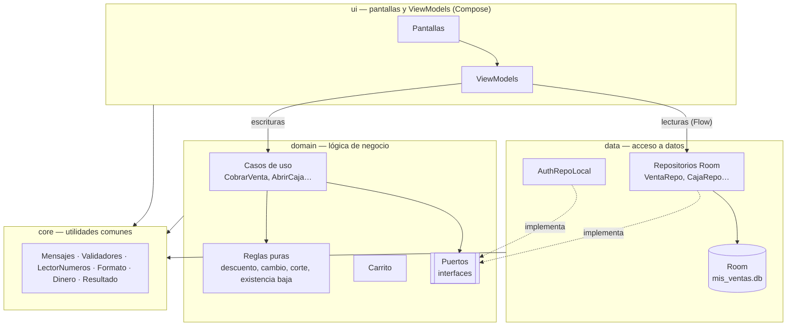
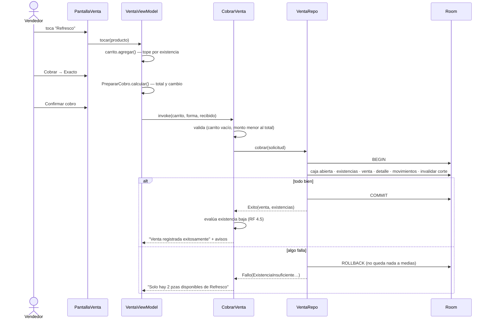

# Arquitectura de la app — *Mis Ventas*

Cómo está organizado el código y por qué. Complementa a
[01-ARQUITECTURA-AGENTICA.md](01-ARQUITECTURA-AGENTICA.md), que explica cómo se organiza el
*trabajo*; este documento explica cómo está hecha la *app*.

Cada decisión indica su **origen**:

| Origen | Significa |
|---|---|
| **DFR** | Lo exige el DFR v1.2 (requerimiento funcional o no funcional). |
| **Plan** | Convención acordada en `00-PLAN-MVP.md` / `CLAUDE.md` del proyecto. |
| **Equipo** | Decisión de diseño tomada al construir, para cumplir lo anterior. No está en el DFR. |

---

## 1. Capas

El RNF de Mantenimiento pide una arquitectura por capas (MVVM) que separe interfaz, lógica de
negocio y acceso a datos **(DFR)**. La app tiene cuatro paquetes **(Plan)**:



| Paquete | Contiene | No contiene |
|---|---|---|
| `core` | Mensajes del DFR, validadores, lectura de montos/cantidades, formato `$0,000.00`, `Resultado`/`Falla`, reloj e ids | Nada de Android ni de Room |
| `domain` | Casos de uso, reglas de cálculo, carrito y **puertos** (interfaces que necesita de los datos) | Consultas SQL, pantallas |
| `data` | Entidades y DAOs de Room, repositorios (con las transacciones), autenticación local, compresión de imágenes | Textos para el usuario |
| `ui` | Pantallas Compose, ViewModels, navegación, tema del logo | Reglas de negocio |

**Simplificación consciente (Equipo):** las *escrituras* (cobrar, abrir caja, registrar producto…)
siempre pasan por un caso de uso; las *lecturas* de listas (catálogo, historial) van directo del
ViewModel al repositorio como `Flow`, porque no tienen reglas que aplicar. Esto evita casos de uso
vacíos que solo reenvían datos.

Las dependencias se arman a mano en `AppContainer` (sin Hilt/Dagger) **(Plan)**.

---

## 2. Del DFR al código

| Exigencia del DFR | Dónde se cumple | Origen |
|---|---|---|
| MVVM por capas (RNF Mantenimiento) | Paquetes `ui` / `domain` / `data` | DFR |
| Validaciones comunes reutilizables: obligatorio, correo, teléfono, montos, cantidades (RNF Reusabilidad) | `core/Validadores.kt`, `core/Validadores.kt › LectorNumeros` | DFR |
| Formato de moneda y cantidades reutilizable; `$0,000.00` y unidad pzas/kg (RNF Reusabilidad e Interfaz) | `core/Formato.kt` | DFR |
| Aislar el backend para cambiarlo sin tocar pantallas ni lógica (RNF Reusabilidad) | `domain/puertos/Puertos.kt`: hoy los implementa Room; en Sprint 2, Firebase | DFR |
| Una venta se registra completa o no se registra (RNF Confiabilidad) | `VentaRepo.cobrar` dentro de una transacción (`data/repository/Transaccion.kt`) | DFR |
| Mensajes de éxito, error y confirmación literales (RNF Interfaz) | `core/Mensajes.kt` (un solo lugar) | DFR + Plan |
| Imagen a máx. 1024 px y 300 KB, automático (RF 2.1, RNF Eficiencia) | `data/imagen/ProcesadorImagen.kt` | DFR |
| El cambio de precio no afecta ventas anteriores (RF 2.2) | `VentaDetalle` guarda nombre y precio del momento | DFR |
| Productos, ventas y formas de pago no se borran (RF 2.3, 3.3, 3.5) | Cambian de estado (`activo`, `estado`) | DFR |
| Cada movimiento de inventario con existencia resultante (RF 4.1 – 4.4) | `MovimientoInventario`, escrito en la misma transacción que cambia la existencia | DFR |
| La contraseña no se guarda en texto plano (RNF Confiabilidad) | `data/auth/Hasheador.kt` (PBKDF2 + sal); temporal hasta Firebase | DFR + Plan |
| Botones ≥ 48 dp; vender 1 producto en ≤ 4 toques (RNF Usabilidad) | `ui/components` (`ALTO_BOTON = 56.dp`), montos rápidos en el cobro | DFR |

---

## 3. Decisiones de diseño

### 3.1 Dinero y cantidades como enteros — **Plan**
Dinero en **centavos** (`Long`) y cantidades en **milésimas** (`Long`): 1 pza = 1000, 0.250 kg = 250.
Nunca `Double`, porque `0.1 + 0.2 ≠ 0.3` en punto flotante y el corte de caja debe cuadrar al centavo.
El importe por peso se redondea a centavos mitad hacia arriba: 0.250 kg × $86.50 = $21.625 → **$21.63**
(`core/Dinero.kt`).

### 3.2 Puertos entre dominio y datos — **Equipo**
El dominio declara qué necesita (`PuertoVentas`, `PuertoCaja`, `PuertoAuth`…) y los repositorios lo
implementan. Dos ventajas:
- **Pruebas:** los casos de uso se prueban en la PC con repositorios falsos en memoria, sin teléfono.
- **Sprint 2:** para usar Firebase basta escribir `AuthRepoFirebase : PuertoAuth`; pantallas y reglas no cambian.

### 3.3 La base de datos no conoce textos — **Equipo**
Cuando una operación no procede, el repositorio responde con un **motivo** (`FallaDatos.ExistenciaInsuficiente`,
`FallaDatos.SinCajaAbierta`…) y el dominio lo traduce al mensaje literal del DFR
(`domain/usecase/Comun.kt › traducir`). Así cada mensaje existe en un solo lugar y la capa de datos
puede cambiarse sin tocar textos.

### 3.4 `Resultado` en lugar de excepciones — **Equipo**
Toda operación devuelve `Resultado.Exito(valor)` o `Resultado.Fallo(falla)`. Hay dos tipos de falla
para la pantalla:
- `FallaCampos`: alerta debajo de cada campo (RNF: "indicar claramente el campo con error").
- `FallaMensaje`: mensaje general en la barra inferior.

Dentro de una transacción sí se lanza una excepción interna, para que Room deshaga todo; al salir se
convierte en `Resultado.Fallo`.

### 3.5 Reglas puras — **Equipo**
Descuento (RF 3.6), cambio (RF 3.2), existencia baja (RF 4.5) y corte (RF 5.2) son funciones sin base
de datos en `domain/regla/Reglas.kt`. Se prueban directamente con los ejemplos del DFR, y el corte que
se guarda en la base usa la misma `ReglaCorte`, para que la fórmula no exista dos veces.

### 3.6 Carrito inmutable y cobro calculado antes de confirmar — **Equipo**
`Carrito` nunca se modifica: agregar o quitar devuelve un carrito nuevo. La pantalla solo reemplaza el
estado y el total se recalcula al instante (RF 3.1: "actualizará el total cada vez que se agregue,
modifique o quite"). `PrepararCobro` calcula total y cambio en cada tecla, para mostrar el cambio antes
de confirmar (RF 3.2).

### 3.7 Corte guardado en la caja — **Equipo**
El resumen del corte se guarda en la propia `Caja` con una marca `corteVigente`. Registrar o cancelar
una venta la pone en `false`, y cerrar la caja exige un corte vigente. Así se cumple RF 5.3: "si se
registran o cancelan ventas después del corte, este deberá actualizarse antes de cerrar".

### 3.8 Registros listos para sincronizar — **Plan**
Toda tabla tiene `id` UUID (no se repite entre teléfonos), `creadoEn`, `actualizadoEn` y
`pendienteSync`. El indicador de la pantalla principal (RF 7.2) cuenta los pendientes; en Sprint 2 el
Módulo 7 enviará esos registros a Firestore.

### 3.9 Autenticación local temporal — **Plan**
El MVP es 100 % local (decisión del 26-oct-2026). La cuenta vive en el teléfono con la contraseña
hasheada. El DFR indica que la contraseña la resguarda Firebase Authentication; esta parte se elimina
al integrarlo en Sprint 2.

---

## 4. Ejemplo: cobrar una venta



---

## 5. Pruebas por capa

| Capa | Pruebas | Dónde corren |
|---|---|---|
| `core` | Validadores, lectura de montos y cantidades, formato, redondeo de importes | PC (JUnit) |
| `domain` | Reglas con ejemplos del DFR, carrito, casos de uso con repositorios falsos, hash de contraseña | PC (JUnit) |
| `data` | Transacciones reales: venta a medias revertida, cancelación, corte, duplicados, ventas de 7 días | Teléfono (pruebas instrumentadas sobre Room en memoria) |
| `ui` | Recorridos manuales en el teléfono, registrados en `02-TRAZABILIDAD-DFR.md` | Teléfono |

Comandos: `./gradlew test` (PC) y `./gradlew connectedDebugAndroidTest` (con el teléfono conectado).

---

## 6. Mapa de archivos

```
mx/ambulantpoint/misventas/
├── MisVentasApp.kt · AppContainer.kt · MainActivity.kt
├── core/        Mensajes, Validadores (+LectorNumeros), Formato, Dinero, Resultado, Reloj
├── domain/
│   ├── puertos/   Puertos.kt (interfaces hacia los datos)
│   ├── regla/     Reglas.kt (descuento, cobro, existencia baja, corte)
│   ├── venta/     Carrito.kt
│   └── usecase/   Catalogo, Inventario, VentaCaja, Usuario + Comun (traducción de fallas)
├── data/
│   ├── local/     MisVentasDb, entity/, dao/
│   ├── repository/ Venta, Caja, Inventario, Catalogo repos + Transaccion + FallaDatos
│   ├── auth/      AuthRepoLocal, Hasheador
│   └── imagen/    ProcesadorImagen
└── ui/          auth, inicio, perfil, categorias, catalogo, caja, venta, historial,
                 components, navigation, theme
```
